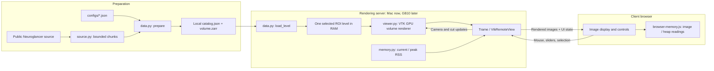

# BigBrain ROI viewer

A small Trame/VTK browser viewer for real 3D BigBrain tissue blocks. It demonstrates server rendering, orbit/pan/zoom, XYZ cuts, a camera-facing cutaway, resolution switching and live memory readings.

Built as a working reference for [Open the Mind, BigBrain Hack issue #16](https://github.com/tfunck/bigbrainhack2026/issues/16). Tested on an Apple Silicon M4 Mac. One selected region and resolution is loaded whole into the rendering process. Whole-brain out-of-core rendering and GB10 performance are not implemented or proven here.

## Quick start

Use Python 3.13, the version tested on the Mac. Python 3.12 or newer is required. Node.js is optional, used only for three browser-monitor unit tests. A fresh installation needs internet access to install dependencies and fetch the sample blocks.

```bash
git clone https://github.com/Montekkundan/bigbrain-roi-viewer.git
cd bigbrain-roi-viewer
PYTHON=python3.13 bash setup.sh
bash 'Start Demo.command'
```

Open **http://127.0.0.1:8081**. The first launch downloads the configured blocks from public chunked sources and prepares local Zarr multiscales. Data, caches and the virtual environment stay local. Keep the terminal running; press **Control+C** or run `bash 'Stop Demo.command'` to stop.

The default is a native 1 µm block with 5 and 20 µm block-averaged versions of the same tissue. Use the dataset selector for the separate original nominal 20 µm block and its 100 µm version. Those two source regions are not atlas aligned. Within one dataset, switching resolution preserves the camera, physical cut positions and intensity/opacity calibration.

## Run only the original 20 µm block

After setup, these commands download and display just that region:

```bash
.venv/bin/python -m openmind prepare \
  --config configs/mac-demo.json --output data/bigbrain-cube
.venv/bin/python -m openmind check --catalog data/bigbrain-cube/catalog.json
.venv/bin/python -m openmind serve --catalog data/bigbrain-cube/catalog.json
```

To prepare the cellular block separately, use `configs/mac-1um-demo.json` and `data/bigbrain-1um-cube`. Add `--compare-catalog PATH` to `serve` for another prepared dataset; the option can be repeated.

## Data and sizes

| Source | Native crop | Field of view | Decoded scalar data | Local derived levels |
|---|---|---|---|---|
| Reconstructed 1 µm VOI1 | 320³ uint8 | 0.32 mm per side | 31.25 MiB | 5 µm: 64³ / 0.25 MiB; 20 µm: 16³ / 4 KiB |
| BigBrain Release 2015, nominal 20 µm | 320³ uint8 | 6.773 × 6.4 × 6.773 mm | 31.25 MiB | Nominal 100 µm: 64³ / 0.25 MiB |

The native 1 µm crop occupies about 29 MB compressed on disk. Decoded size is 32,768,000 bytes. The original nominal 20 µm source has actual spacing **21.1667 × 20 × 21.1667 µm**, which the code preserves.

Each config specifies XYZ voxel coordinates, shape, source scale, concurrency and data budget. Each dimension must be divisible by every downsampling factor. Change the output directory for a different crop. Only intersecting source chunks are fetched. Preparation writes compressed Zarr v3 arrays with OME-Zarr 0.5 multiscale transforms, provenance and SHA-256 voxel hashes. Coarse levels use integer block means with nearest-even rounding and cell-center origins that preserve physical cell edges. Arrays use ZYX order; no published atlas-registration affine is applied.

The [BigBrain FTP catalog](https://ftp.bigbrainproject.org/bigbrain-ftp/) provides the release data. This demo uses corresponding public Neuroglancer chunks to fetch a bounded block without downloading a full FTP volume.

## Read the memory panel

The **server** panel shows exact active scalar bytes, current process resident RAM, historical process peak and VTK render time. The **browser** receives rendered images, with **0 B of volume voxels** transferred. Its panel shows the current encoded image size, an estimated decoded image buffer (`width × height × 4`), displayed-image updates and approximate JavaScript heap when the browser exposes it.

The image estimate excludes VTK queues, decoder pools, canvas/compositor copies and GPU allocations. JavaScript heap is approximate and may include shared allocations. Exact total tab/GPU memory is unavailable. The monitor keeps at most 60 numeric history samples; it does not save a frame history.

**Release data** removes the browser view, detaches the scalar input and requests graphics-resource release. Active voxel/image readings become zero; **Reload data** restores the selection. VTK can retain a detached scalar buffer until a later load/render, and allocators or browser garbage collection can delay reclamation. Zero active data does not mean zero total memory. On the Mac, server and browser use the same physical computer.

## Architecture

```text
bigbrain-roi-viewer/
├── configs/
│   ├── mac-demo.json                  # Original nominal 20 µm region
│   ├── mac-1um-demo.json              # Native 1 µm region and derived levels
│   └── gb10-larger-roi.example.json   # Untested larger region
├── src/openmind/
│   ├── __main__.py                    # CLI: prepare, check, serve
│   ├── source.py                      # Bounded concurrent source-chunk downloads
│   ├── data.py                        # Zarr preparation, hashes and level loading
│   ├── viewer.py                      # Trame controls, VTK rendering and cuts
│   ├── memory.py                      # Current and peak server process RAM
│   ├── browser_memory.py              # Registers the browser widget and its events
│   └── static/browser-memory.js       # Browser image/heap readings and history
├── tests/                            # Data, cuts, recovery and memory regressions
├── pyproject.toml                    # Package, dependencies and browser asset
├── setup.sh                          # Creates .venv and installs the package
├── Start Demo.command                # Prepares missing data and starts the viewer
├── Stop Demo.command                 # Stops the recorded demo process
├── README.md
└── LICENSE
```

Preparation generates `data/<region>/catalog.json` and `data/<region>/volume.zarr/`. The catalog records source provenance, shapes, spacing, origins and voxel hashes; the Zarr store holds the native and averaged levels. This generated data is ignored by Git.



`prepare` streams intersecting source chunks into local Zarr and builds coarse levels in blocks. `serve` reads the catalogs, loads one selected level through `load_level`, shares its NumPy scalar buffer with VTK, and exposes the controls through Trame. `check` reads stored voxel data to verify the catalog hashes.

Orbit, zoom and cut changes update the existing server-side renderer and send new images to the browser. They keep the selected volume loaded. Dataset or resolution changes load another complete bounded level. The browser does not fetch or render the 3D voxel array. The memory widget samples browser readings locally and requests server RAM updates once per second.

For extension, keep source-format access in `source.py`, pyramid/catalog handling in `data.py`, and renderer/cache integration in `viewer.py`. A future brick cache must replace the complete-level loading/rendering path shown above; changing configuration limits alone will not add streaming.

## Reuse and GB10

For Linux/GB10, clone the repository and create a fresh environment there. Compatible ARM64 wheels, the NVIDIA driver and VTK OpenGL/EGL GPU rendering must be validated on the actual machine. Bind the server to loopback and forward the port:

```bash
# Run on the GPU host after setup and preparation:
.venv/bin/python -m openmind serve \
  --catalog data/bigbrain-cube/catalog.json --host 127.0.0.1 --port 8081

# Run on the client, using your SSH host:
ssh -L 8081:127.0.0.1:8081 YOUR_GPU_HOST
```

`configs/gb10-larger-roi.example.json` is an untested 640³ crop. Its native level needs a larger scalar limit, for example `--max-volume-mib 384`. This does not cap total process/GPU memory or guarantee full-resolution GPU textures.

To complete issue #16, the renderer still needs view-dependent brick/level selection, bounded host and GPU caches, coarse fallback, asynchronous loading/eviction and seam-correct sampling. Validate these against a dense reference, then benchmark traversal of data larger than RAM with declared cache budgets. Measure peak host/GPU allocations and end-to-end browser latency; the existing render timer and RAM meter do not establish flat-memory scaling. Raising this viewer's ROI limit does not implement that architecture.

## Verify

```bash
.venv/bin/python -m unittest discover -s tests -v
.venv/bin/python -m pip check
node --test tests/test_browser_memory.cjs
```

Fresh Python 3.13 installation and wheel packaging were checked on the Mac. The prototype passed 30 Python tests and 3 JavaScript tests. Coverage includes source chunk ordering/edges, malformed responses, block means, coordinate alignment, scalar budget rejection, dataset recovery, release/reload and memory accounting. All five prepared levels were hash-checked and rendered offscreen. Browser checks covered orbit/zoom, XYZ cuts, dataset/resolution switching and memory-panel release/reload. These are Mac results; GB10 remains untested.

## License and data attribution

Code is provided under the [MIT license](LICENSE). No tissue data is committed. Downloaded data and its derived crops retain their own **CC BY-NC-SA 4.0** terms:

- **1 µm VOI1:** Huysegoms, Bludau, Oliveira, Upschulte, Dickscheid and Amunts (2022), *Cellular level 3D reconstructed volumes at 1 µm resolution within the BigBrain occipital cortex*, [DOI:10.25493/K8Q7-CG9](https://doi.org/10.25493/K8Q7-CG9). This source contains two reconstructed 6 mm VOIs, not a whole brain at 1 µm. [Source configuration](https://raw.githubusercontent.com/FZJ-INM1-BDA/siibra-configurations/v1/features/images/vois/cellbody/d71d369a-c401-4d7e-b97a-3fb78eed06c5_huysegoms_voi_1.json); [license evidence](https://raw.githubusercontent.com/ome/ome2024-ngff-challenge/main/samples/fzj.csv).
- **Original release:** Amunts et al. (2013), *BigBrain: An Ultrahigh-Resolution 3D Human Brain Model*, Science 340, 1472–1475, [DOI:10.1126/science.1235381](https://doi.org/10.1126/science.1235381). [Source configuration](https://raw.githubusercontent.com/FZJ-INM1-BDA/siibra-configurations/v1/spaces/bigbrain_2015.json); [data license](https://ftp.bigbrainproject.org/bigbrain-ftp/License.txt).
